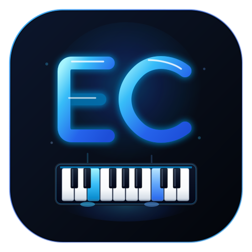

<p align="center">
  
</p>

<h1 align="center">Emochord v2</h1>

<p align="center">
  <strong>Çevrimdışı piyano pratik stüdyosu ve MIDI düşen nota görselleştiricisi.</strong><br>
  Electron ve Web Audio API ile geliştirilmiştir. Etkileşimli tuş beklemeli pratik, anlık akor analizi ve sıfır telemetri sunar.
</p>

<p align="center">
  <a href="https://github.com/Emolili999/emo-chord/blob/main/LICENSE"></a>
  
  
  
  
  
</p>

<p align="center">
  <a href="README.md">English</a> &bull; <strong>Türkçe</strong>
</p>

---

## Genel Bakış

**Emochord**, piyano repertuarı çalışmak ve Standart MIDI Dosyalarını (`.mid`, `.midi`) görselleştirmek için tasarlanmış bağımsız bir masaüstü uygulamasıdır. Polifonik nota dizilimlerini, sanal piyano klavyesiyle senkronize HTML5 Canvas nota akışına dönüştürür.

Uygulama, herhangi bir harici ağ bağlantısı, üyelik veya veri takibi olmaksızın tamamen yerel donanımda çalışır. Donanımsal USB/MIDI klavyeler (Web MIDI API), standart bilgisayar klavyesi ve fare girişi desteklenir.

---

## Temel Yetenekler

### Pratik Motorları

* **Tuş Beklemeli Mod (Etkileşimli Pratik):** Nota çubukları vuruş çizgisine ulaştığında çalma zaman çizelgesi duraklar ve yalnızca kullanıcı doğru notayı bastığında ilerler. Eşlik eden notalar senkron kalır; icracının tempo baskısı olmadan zorlu pasajları çalışmasına olanak tanır.
* **Ritim Modu:** Notalar seçilen tempo çarpanında (%25 - %200) kesintisiz akar. Motor, vuruş zamanlama sapmalarını kaydeder; doğruluğu *Mükemmel*, *İyi* veya *Kaçırdı* olarak puanlar ve kombo çarpanlarını hesaplar.
* **Serbest Çalma Modu:** Bağımsız bir dijital enstrüman görevi görür. Basılan notalar yukarı yönlü şelale akışı oluşturur ve icra doğrudan standart Type-0/Type-1 MIDI dosyası veya JSON kaydı olarak dışa aktarılabilir.
* **İzleme ve Dinleme Modu:** Gerçek zamanlı klavye ışıklandırması eşliğinde karmaşık müzik düzenlemelerinin görsel ve işitsel analizini sağlar.

### Gerçek Zamanlı Müzik Analizi

* **Akor Algılama (HUD):** Aktif perde kümelerini eşzamanlı olarak analiz eder ve akor tanımlarını (majör, minör, eksik, artık, askıda, 7'li akorlar) üst bilgi panelinde anlık olarak görüntüler.
* **Kanal ve El Ayrımı:** Polifonik kanalları otomatik olarak sağ el (tiz) ve sol el (bas) akışlarına ayırır; tek el izolasyonu veya iki el birlikte çalışmayı destekler.
* **A-B Döngü Motoru:** Zaman çizelgesi üzerinde başlangıç ($A$) ve bitiş ($B$) noktaları belirleyerek belirli ölçülerin sürekli döngüde tekrar edilmesini sağlar.
* **Sustain Pedalı Desteği:** Fiziksel MIDI sustain pedallarını (Control Change 64) ve bilgisayar boşluk tuşunu doğal akustik sönümleme modellemesiyle destekler.

### Ses ve Sentezleme Motoru

Emochord, Web Audio API üzerine kurulu algoritmik bir ses sentezleyici kullanır; harici ses bankası (GB'larca sample) indirme gereksinimini ortadan kaldırır:

* **Konser Piyanosu:** Çekiç vuruşu ve tel rezonansını modelleyen çoklu osilatör akustik yapısı.
* **Elektrik Piyano (Rhodes):** Klasik elektro-akustik ton yanıtını simüle eden frekans modülasyonlu sentez.
* **Neon Sentezleyici:** Alçak geçiren filtreli modern tını.
* **Kilise / Bar Orgu:** Toplamsal harmonik drawbar mimarisi.

---

## Tuş Kısayolları

| Tuş | Kapsam | Eylem |
| :--- | :--- | :--- |
| `Space` | Çalma | Oynat / Duraklat |
| `Space` | Serbest Çalma | Basılı tutulduğunda sustain pedalını etkinleştirir |
| `M` | Genel | Ayarlar çekmecesini aç / kapat |
| `F` / `F11` | Genel | Çerçevesiz tam ekranı aç / kapat |
| `R` | Çalma | Zaman çizelgesini başa sar ($00:00$) |
| `[` / `]` | Çalma | Tempoyu %5 azalt / artır |
| `A`, `W`, `S`... | Giriş | Bilgisayar klavyesini piyano tuşlarına eşler |
| `Esc` | Genel | Açık panelleri ve çekmeceleri kapat |

---

## Sistem Gereksinimleri

* **İşletim Sistemi:** Linux (x86_64 AppImage) veya Windows 10/11 (x64 Portable)
* **Çalışma Zamanı:** [Node.js](https://nodejs.org/) v18.0.0 veya üzeri (kaynak koddan derleme için)
* **Paket Yöneticisi:** `npm` v9.0.0 veya üzeri

---

## Kurulum ve Derleme Talimatları

### Depoyu Klonlama ve Bağımlılıklar

```bash
git clone https://github.com/Emolili999/emo-chord.git
cd emo-chord
npm install
```

### Uygulamayı Çalıştırma

```bash
# Masaüstü Electron uygulamasını başlatır
npm start

# Yerel web sunucusunu başlatır (http://127.0.0.1:3030)
npm run web

# Birim testlerini çalıştırır
npm test
```

### Kurulum Paketleri Oluşturma

Paketleme işlemi `electron-builder` ile yönetilir:

```bash
# Linux AppImage derler
npm run dist

# Windows Portable (.exe) derler
npm run dist:win

# Her iki platform için paket derler
npm run dist:all
```

Derlenen dosyalar `dist/` klasörü altına oluşturulur:
* `dist/Emochord-v2-2.0.0-x86_64.AppImage`
* `dist/Emochord-v2-2.0.0-Portable.exe`

---

## Dahili Klasik Eserler

`assets/midi/` dizininde kullanıma hazır kamu malı düzenlemeler yer almaktadır:

* **J.S. Bach:** *Prelude in C Major (BWV 846)*
* **L. v. Beethoven:** *Für Elise (WoO 59)*
* **L. v. Beethoven:** *Ode to Joy (9. Senfoni, Op. 125)*
* **W.A. Mozart:** *Rondo alla Turca (Piyano Sonatı No. 11, K. 331)*
* **Geleneksel:** *Twinkle, Twinkle, Little Star*

İstediğiniz herhangi bir MIDI dosyası sürükle-bırak yöntemiyle veya dosya seçici üzerinden doğrudan yüklenebilir.

---

## Güvenlik ve Gizlilik

* **Sıfır Ağ Trafiği:** Uygulama tamamen çevrimdışı çalışır. Dışarıya dönük HTTP/WebSocket bağlantısı kurmaz, harici CDN yüklemez ve telemetri toplamaz.
* **Electron İzolasyonu:** Ana pencerede `contextIsolation: true`, `nodeIntegration: false` ve `sandbox: true` politikaları uygulanır. Yetkisiz pencere açma veya gezinme istekleri engellenir.
* **Yerel Veri Saklama:** Ayarlar ve kullanıcı kayıtları yalnızca işletim sisteminin standart yerel kullanıcı dizinlerinde saklanır.

---

## Lisans

Bu proje [MIT Lisansı](./LICENSE) altında sunulmaktadır.

```
Copyright (c) 2026 Emolili999
```
